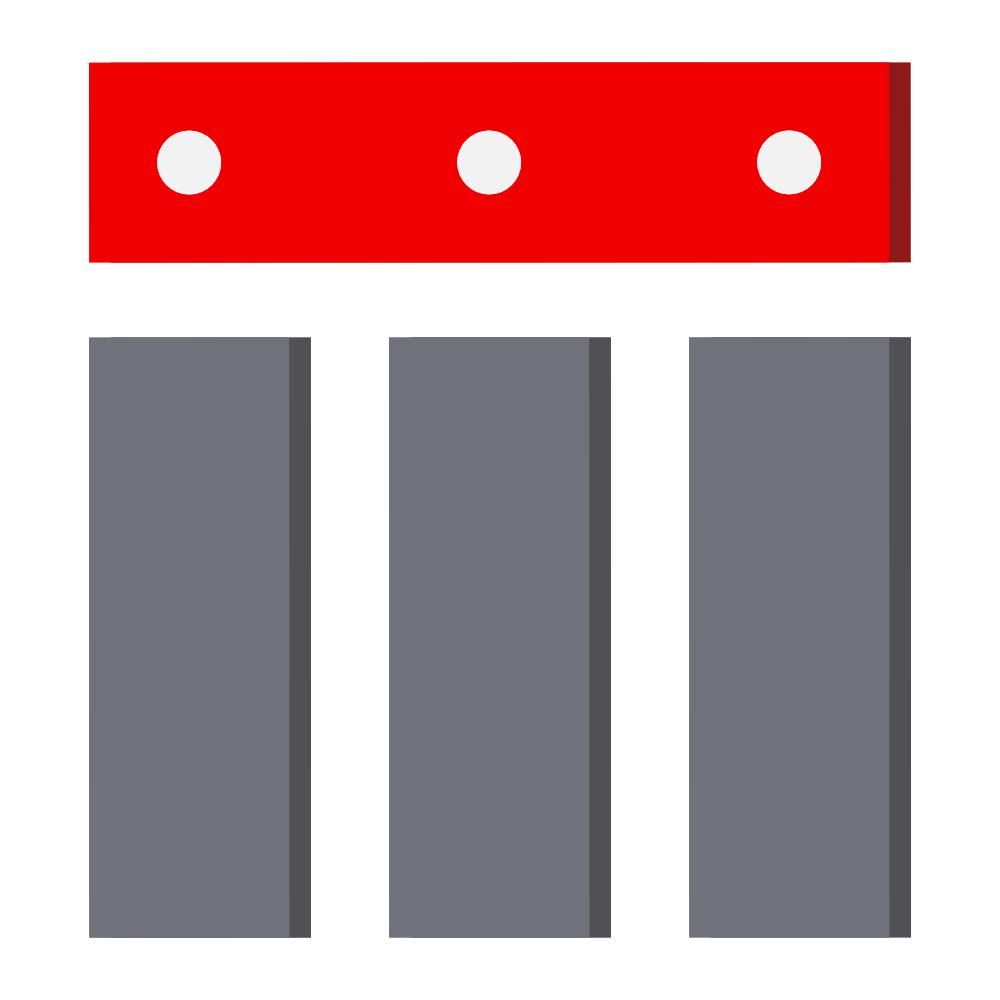

# Tessellate




**Tessellate** is a pattern maker you can run right in your browser. Arrange motifs into seamless repeating tiles, then export them as SVG or PNG. It’s a single file, so there’s nothing to install and no internet connection needed.

Open **`Tessellate.html`** to get started.

## Get it

**[Download `Tessellate.html` (282 KB, standalone)](https://github.com/Eandab0t/Tessellate/blob/main/package/Tessellate.html)**

Save it wherever you like — on your desktop, a USB stick, or a network drive — then open it in a modern browser. Tessellate runs on your device, so uploaded images stay on your machine.

## What it does

| | |
|---|---|
| **Motif library** | Start with 8 built-in motifs, or add your own by dragging them in or browsing for files (SVG · PNG · JPG · WebP · GIF, up to 25 MB each). Large icons are scaled down to 512 px. |
| **Layouts** | Choose grid, scatter, or cycle. Grid options include align, half-drop, half-slide, diagonal, and alternating flip. |
| **Variation** | Adjust scale, rotation, and opacity, either directly or across a random range. You can also tune density, stagger, and jitter, avoid collisions, and wrap motifs across tile edges. |
| **Canvas** | Make tiles up to 3840×3840, choose a locked aspect ratio (1:1, 16:9, 4:3, 3:2, or 2:1), set a background colour, and show tile boundaries. Seeds let you reproduce a layout. |
| **Preview** | See your pattern on a scrollable dotted canvas, with repeat previews from 1×1 to 4×4, zoom from 25% to 300%, and live bounds. |
| **Export** | Save a single tile or repeated grid as SVG, export a high-resolution PNG (2.5× scale), or save your settings as JSON and load them later. |

## Dark card design

The interface uses the **EanTessellate** look: a dark workspace, red accents, card-style panels, and a dotted canvas.

## Build it yourself

```sh
git clone https://github.com/Eandab0t/Tessellate.git
cd Tessellate
npm install
npm run build   # -> package/Tessellate.html (single self-contained file)
npm run lint    # TypeScript check
```

The pattern engine is in `src/utils/patternMath.ts`; the rest of the app is built around it.

## License

[MIT](LICENSE) — free to use, modify, and distribute.

---

<p align="center"><b>Tessellate</b> · make seamless patterns, anywhere</p>
